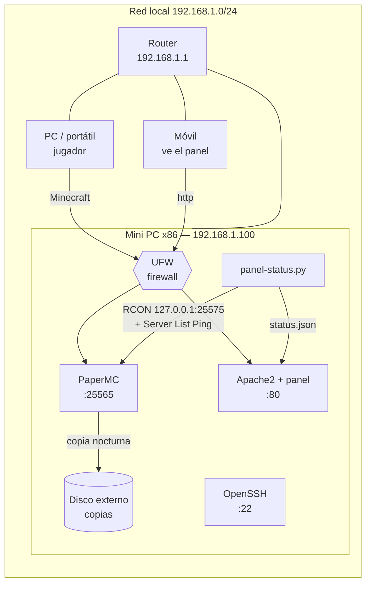

# 02 · Arquitectura del servidor

## Esquema general



- **Desde Internet no se puede entrar.** El router no redirige ningún puerto. Si algún amigo quiere jugar desde fuera, se usa una VPN (Tailscale o WireGuard), nunca puertos abiertos ([05-seguridad.md](05-seguridad.md)).
- **RCON** (la consola remota de Minecraft) solo la usa el recolector del panel desde el propio servidor. El firewall no la abre.

## Puertos

| Puerto | Servicio | Desde dónde | Abierto en UFW |
|---|---|---|---|
| 22/tcp | SSH | LAN | Sí (solo LAN) |
| 80/tcp | Panel web (Apache2) | LAN | Sí (solo LAN) |
| 25565/tcp | Minecraft | LAN | Sí (solo LAN) |
| 25575/tcp | RCON de Minecraft | Solo el propio servidor (el firewall lo bloquea desde fuera) | **No** |
| 3000/tcp | Open WebUI (extra opcional) | LAN | Solo si se instala |
| 8006/tcp | Interfaz web de Proxmox (opción A) | LAN | La gestiona Proxmox |

## Cómo se reparte el equipo con Alberto

El mini PC lo compartimos dos personas. Hay dos formas de hacerlo:

### Opción A (recomendada): Proxmox VE como base

```
Mini PC (Proxmox VE)
├── CT 101  mc-server   (Debian 13, LXC)  ← Andrés: Minecraft + panel
│           4 núcleos · 8 GB RAM · 40 GB disco
├── VM/CT 2xx           ← Alberto: su homelab
│           resto de recursos · disco externo
└── Disco externo 1-2 TB → copias (vzdump) + datos de Alberto
```

**Ventajas:**
- Si Alberto rompe algo, mi servidor sigue funcionando (y al revés).
- **Snapshots:** antes de un cambio arriesgado se hace una instantánea y, si sale mal, se vuelve atrás en segundos.
- Copias de seguridad completas de cada máquina con `vzdump`.
- Es lo que se usa en homelabs reales y en muchas empresas. Encaja con SOR y SEIN.

**A tener en cuenta:**
- Usar un **contenedor LXC** (no una VM) para Minecraft. Comparte el kernel del host, gasta menos RAM y suele poder leer los **sensores de temperatura** del host (compruébalo con `ls /sys/class/hwmon` dentro del contenedor). Dentro de una VM no se ven las temperaturas reales y el panel mostrará "N/D".
- 128 GB de SSD dan para Proxmox (~15 GB), mi contenedor (40 GB) y algo de Alberto. Lo grande va al disco externo.

### Opción B (más simple): Debian 13 directamente

Se instala Debian en el mini PC y cada uno usa su usuario (`EXTRA_SSH_USERS="alberto"` en `config.env`). Es más fácil y los scripts funcionan igual, pero no hay aislamiento: los dos compartimos el mismo sistema.

**Los scripts de este repositorio funcionan en los dos casos.** Se ejecutan dentro del Debian 13, ya sea el contenedor de Proxmox o el sistema instalado directamente.

## Reparto de recursos orientativo (16 GB de RAM)

| Uso | RAM |
|---|---|
| Proxmox / sistema base | ~1,5 GB |
| Minecraft (Java `-Xmx4G`) + sistema del contenedor | ~5-6 GB |
| Panel + Apache2 | < 100 MB |
| Homelab de Alberto | ~6-8 GB |
| Margen | ~1 GB |
