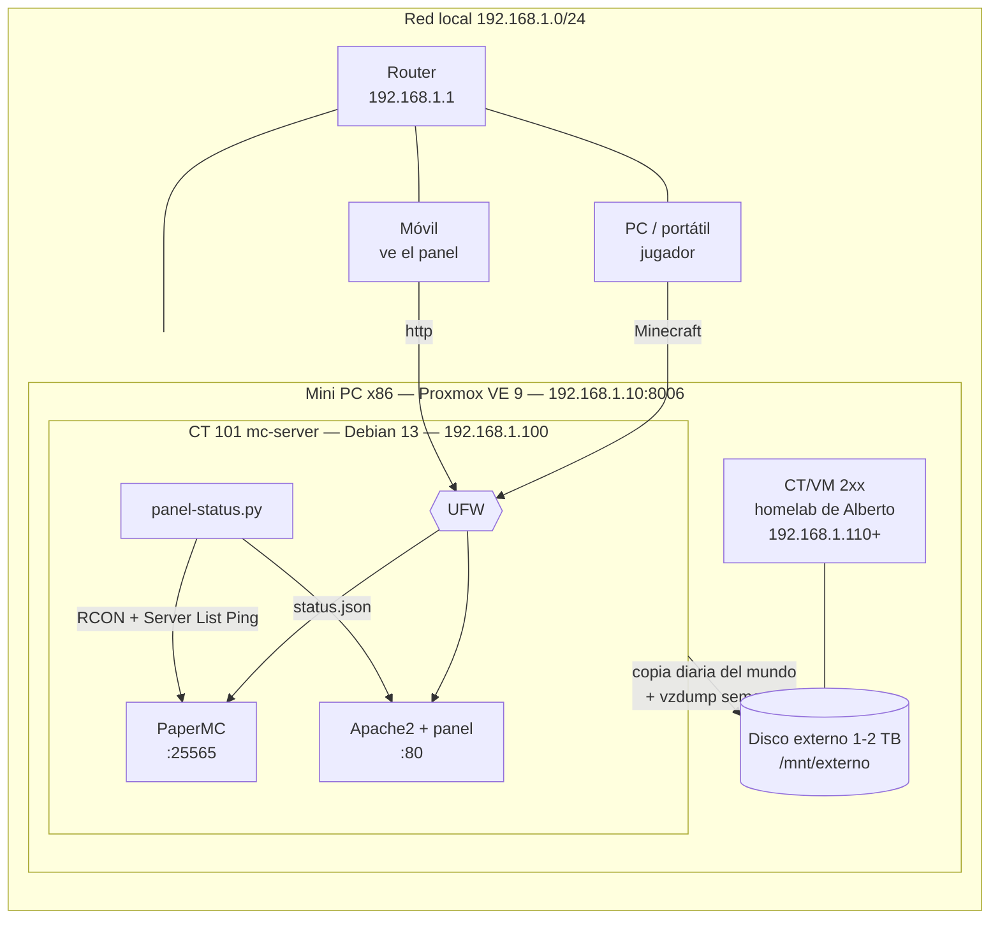

# 02 · Arquitectura del servidor

**Decisión:** el mini PC lleva **Proxmox VE 9** como sistema base (hipervisor). Cada servicio va en su propio contenedor LXC o máquina virtual. Minecraft y el panel van en el **CT 101 (Debian 13)**, y Alberto monta su homelab al lado, sin que un proyecto afecte al otro.

## Esquema general



## Organización dentro de Proxmox

```
Mini PC — Proxmox VE 9 (Debian 13 por debajo)       IP 192.168.1.10
│   SSD 128 GB  → Proxmox (~15 GB) + local-lvm (discos de CT/VM)
│   Disco externo 1-2 TB montado en /mnt/externo
│       ├── ct101/     copias diarias del mundo (dentro del CT se ve como /mnt/externo)
│       ├── proxmox/   copias completas vzdump (almacenamiento "externo")
│       └── alberto/   datos del homelab de Alberto
│
├── CT 101  mc-server   Debian 13 · unprivileged · nesting    IP 192.168.1.100
│           4 núcleos · 8 GB RAM · 40 GB · arranque automático
│           PaperMC · Apache2 + panel · panel-status · fail2ban · UFW
│
└── CT/VM 2xx           homelab de Alberto                     IP 192.168.1.110+
            resto de recursos
```

| Elemento | ID / IP | Responsable |
|---|---|---|
| Proxmox (web de gestión) | `https://192.168.1.10:8006` | Los dos |
| CT 101 `mc-server` | `192.168.1.100` | Andrés |
| CT/VM 200-299 | `192.168.1.110` – `192.168.1.149` | Alberto |

> Conviene reservar esas IPs en el router, o sacarlas del rango DHCP, para que no las coja otro dispositivo.

## ¿Por qué un contenedor LXC y no una máquina virtual?

| | Contenedor LXC | Máquina virtual |
|---|---|---|
| Kernel | Comparte el del host | Tiene el suyo propio |
| RAM | Solo usa la que necesita | Reserva la que le asignes |
| Arranque | 2-3 segundos | 20-40 segundos |
| Temperaturas en el panel | Puede leer los sensores del host | No las ve ("N/D") |
| Snapshots y copias | Sí | Sí |
| Cuándo usarla | Servicios Linux (como este) | Otro SO (Windows), Docker o aislamiento total |

Minecraft, Apache y el panel son servicios Linux normales, así que un **CT sin privilegios** (*unprivileged*) es lo más eficiente y lo más seguro: el root del contenedor no es root en el host.

## Puertos

| Puerto | Dónde | Servicio | Desde |
|---|---|---|---|
| 8006/tcp | Proxmox `.10` | Web de gestión de Proxmox | LAN |
| 22/tcp | Proxmox `.10` | SSH del host | LAN |
| 22/tcp | CT 101 `.100` | SSH del contenedor | LAN (UFW) |
| 80/tcp | CT 101 `.100` | Panel web | LAN (UFW) |
| 25565/tcp | CT 101 `.100` | Minecraft | LAN (UFW) |
| 25575/tcp | CT 101 `.100` | RCON (consola remota) | Solo el propio CT: UFW lo bloquea desde fuera |

**Desde Internet no se puede entrar:** el router no redirige ningún puerto. Para jugar desde fuera se usa VPN ([05-seguridad.md](05-seguridad.md)).

## Reparto de recursos (16 GB de RAM)

| Uso | RAM |
|---|---|
| Proxmox (host) | ~1,5-2 GB |
| CT 101: Minecraft (Java `-Xmx4G`) + sistema | hasta 8 GB (normalmente usa ~5 GB) |
| Homelab de Alberto | ~5-6 GB |
| Margen | ~1 GB |

Las cifras de CPU y RAM de cada CT se cambian en caliente desde la web de Proxmox (CT → Recursos). Ajustarlas es la parte de optimización que dejamos para más adelante.

## Alternativa descartada: Debian directamente en el mini PC

Sería más simple, pero los dos compartiríamos el mismo sistema: un fallo o un cambio de uno afectaría al otro, y no habría snapshots. Los scripts de `scripts/` siguen funcionando en un Debian 13 normal, y eso se aprovecha para **probarlos en una VM** antes de tener el hardware ([03-simulacion.md](03-simulacion.md)).
