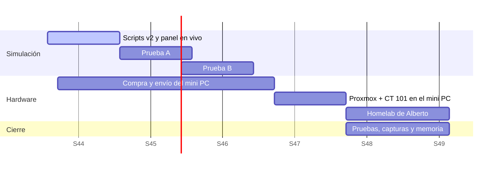

# 06 · Planificación, estado y pruebas

## Fases (8 semanas)

> Ya completado antes: investigación del hardware, cambio a x86 y VM Debian 13 con Apache2. Las fechas son orientativas. La compra depende del envío de AliExpress o Temu (1-3 semanas).

## Estado actual

- [x] Propuesta de idea y cambio de Raspberry Pi 5 a mini PC x86
- [x] VM Debian 13 con Apache2 y la primera versión del panel
- [x] Scripts v2: base y seguridad, PaperMC, panel, copias
- [x] Panel con datos en vivo (`status.json`) y modo demo
- [x] Decisión: Proxmox VE 9 como base, con Minecraft en un CT LXC (Debian 13)
- [x] Scripts del host Proxmox: postinstalación, creación del CT 101, vzdump
- [ ] Prueba A: scripts de servicios en una VM con Debian 13
- [ ] Prueba B: Proxmox en una VM, crear el CT 101 con el script
- [ ] Comprar el mini PC (presupuesto ~150 €)
- [ ] Instalar Proxmox en el mini PC y desplegar el CT 101
- [ ] Homelab de Alberto en su propio CT/VM
- [ ] Pruebas de rendimiento y memoria final

## Plan de pruebas

Cada prueba con su captura de pantalla, para la memoria.

| # | Prueba | Cómo | Resultado esperado |
|---|---|---|---|
| 1 | Servicios activos tras reiniciar | Reiniciar el **host** Proxmox → `bash scripts/estado-servicios.sh` en el CT | El CT 101 arranca solo y todo está `active` |
| 2 | Conexión al servidor de Minecraft | Desde otro PC de la LAN | Entra; un jugador fuera de la whitelist **no** entra |
| 3 | Panel en vivo | Abrir `http://IP` desde el móvil | Se ven jugadores, TPS, RAM y CPU actualizándose |
| 4 | Detección de caídas | `sudo systemctl stop minecraft` | El panel pone APAGADO y añade un evento en el historial |
| 5 | Rendimiento | 3-5 jugadores explorando 15 min | TPS ≥ 19,5 y MSPT < 50 ms |
| 6 | Firewall | `nmap 192.168.1.100` desde otro equipo | Solo 22, 80 y 25565 abiertos |
| 7 | fail2ban | 5 logins SSH fallidos | La IP queda bloqueada |
| 8 | Copia y restauración | `sudo backup-minecraft` y restaurar ([05-seguridad.md](05-seguridad.md)) | El mundo vuelve al estado de la copia |
| 9 | Corte de luz | Desenchufar y enchufar | Arranca solo (BIOS) y vuelven todos los servicios |
| 10 | Consumo | Enchufe medidor, en reposo y con carga | Dato en W y coste al mes |
| 11 | Snapshot | Snapshot del CT 101 → borrar `/var/www/html/index.html` → revertir | El panel vuelve a estar como antes en segundos |
| 12 | Restaurar el CT entero | Restaurar el último vzdump como CT 901 | El CT 901 arranca con el mundo y el panel |
| 13 | Aislamiento | Parar o reiniciar el CT de Alberto | Minecraft y el panel siguen funcionando |
| 14 | Permisos | Entrar en la web con `alberto@pve` | No ve ni puede tocar el CT 101 |

## Módulos de 1º y 2º de SMR

| Módulo | Curso | Qué se aplica | Enfoque |
|---|---|---|---|
| Sistemas Operativos Monopuestos | 1º | Instalación de Debian, terminal, systemctl, usuarios y permisos | Práctico |
| Redes de Área Local | 1º | LAN, IP fija o reserva DHCP, puertos TCP, modelo OSI | Teórico/práctico |
| Montaje y Mantenimiento de Equipos | 1º | Elección del mini PC, BIOS, discos, consumo | Teórico/práctico |
| Aplicaciones Web | 1º | Panel HTML5/CSS3/JS que consume JSON con `fetch()` | Práctico |
| Sistemas Operativos en Red | 2º | Proxmox VE: contenedores LXC, recursos, usuarios y permisos por pool, snapshots; servicios systemd | Práctico |
| Seguridad Informática | 2º | UFW y firewall de Proxmox, CT sin privilegios, SSH con clave, fail2ban, copias 3-2-1 (mundo + vzdump) | Teórico/práctico |
| Servicios en Red | 2º | Apache2, PaperMC, RCON, gestión de puertos | Práctico |

## Relación con los ODS

**ODS 9 (Industria, innovación e infraestructura):** una infraestructura propia, de bajo coste (~150 €), con software libre (Proxmox VE, Debian, Apache2, PaperMC), sin depender de servicios de pago en la nube. Gracias a la virtualización, un solo equipo da servicio a dos proyectos: se aprovecha mejor el hardware y la energía.
